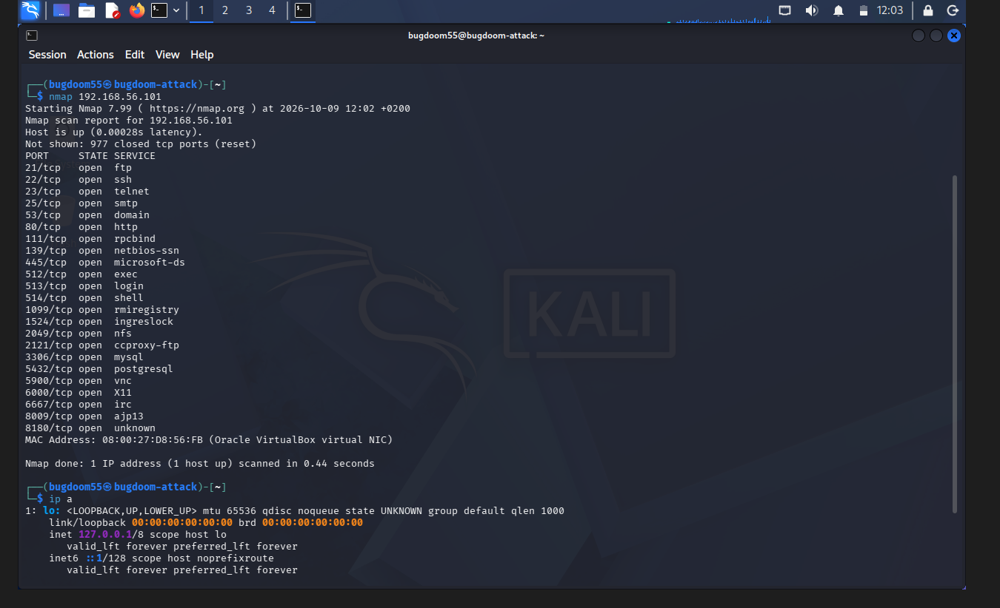

My name is Skander Badri and this is my e-portfolio. I am a computer science student at ENSEEIHT in my first year (Bac+3) and I am looking
forward to learning new things, widening my horizons and discover the world of Cybersecurity !


# Engineering Course

## Projects
<details>
<summary class = "projects-title">Home lab project</summary>
<figure>

<figcaption>Figure 1: Port scanning Metasploitable 2</figcaption>
</figure>
</details>


<!-- * ## *Guessing game* remastered -->

## Achievements
* ### *7TF* challenge        <!-- Should I put it ? -->

I placed in the top 3 among first-years at ENSEEIHT in the recent CTF challenge organized by the pony7 club. 

# International Mobility

## Mobility projects

```
In progress :)
```

## English

```
Nothing for the moment :\

```

## 我说汉语 ！

你好 ！我叫 Skander Badri。 我十九岁。我喜欢学汉语 ！

## German

Hallo ! Ich bin Skander Badri und Ich spreche ein bisschen deutsch.

## Spanish

```
Pronto :)
```
# Sustainability & Civic Engagement

## For Mother Nature ...

```
Awaiting permission ...
```

## " Cordées de la reussite " project


I am participating in the project "Cordées de la reussite" and my role is to give first-years in high school carreer/academic counseling and to give them the push they need to feel more confident public speaking !

# Sport & other activities

## Sports

I like to go to the gym to build muscle and discipline. My body lives for sore muscles !

<!-- I really need to add more :\\ -->
# Career Development

## CV / Resume

```
In progress ...

```

## Contact

```
In progress ...
```

## My mentors

```
In progress ...
```

<!-- I still need my elevator pitch -->