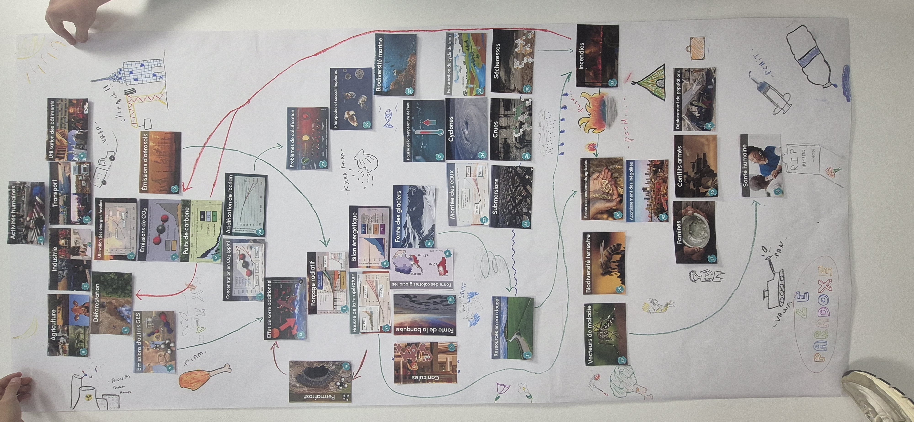

My name is Skander Badri and this is my e-portfolio. I am an engineering student at ENSEEIHT in my first year (Bac+3) and I am looking
forward to learning new things, widening my horizons and discover the world of Cybersecurity !


# Engineering Course

## Projects
<details>
<summary class = "projects-title">Home lab project</summary>
<figure>

<figcaption>Figure 1: Port scanning Metasploitable 2</figcaption>
</figure>
</details>


<!-- * ## *Guessing game* remastered -->

## Achievements
* ### *7TF* challenge        <!-- Should I put it ? -->

I placed in the top 3 among first-years at ENSEEIHT in the recent CTF challenge organized by the pony7 club. 

# International Mobility

## Mobility projects

```
In progress :)
```

## Arabic
<div dir="rtl">
اللغة العربية لغتي الأم. اسمي بالعربية يكتب كالاتي : اسكندر بادري.
</div>

## English

Well, this entire e-portfolio is in english so...

## 我说汉语 ！

你好 ！我叫 Skander Badri。 我十九岁。我喜欢学汉语 ！

## German

Hallo ! Ich bin Skander Badri und Ich spreche ein bisschen deutsch.

## Spanish

```
Pronto :)
```
# Sustainability & Civic Engagement

## For Mother Nature ...
<figure>

<figcaption>Fresque du climat : Le paradoxe</figcaption>
</figure>
## " Cordées de la réussite " project


I am participating in the project "Cordées de la reussite" and my role is to give first-years in high school carreer/academic counseling and to give them the confidence boost they need in public speaking !

## Le procès de King Kong

I attended the play "Le procès de King Kong" displaying 3 situations of sexist and sexual violence (VSS) at the end of wich we had to pass judgement and debate on who was the most at fault in said situation.
# Sport & other activities

## Sports

I like to go to the gym to build muscle and discipline. My body lives for sore muscles !

<!-- I really need to add more activities :\\ -->
# Career Development

## CV / Resume

<a href="/assets/docs/Mr_Skander_Badri_Resume_2026-10-29.pdf" download class="contact-btn">Download Resume</a>

## Contact

Join me on LinkedIn !

<a href="https://www.linkedin.com/in/skander-badri-536462222/?locale=en-US" class="contact-btn">LinkedIn (EN)</a>
<a href="https://www.linkedin.com/in/skander-badri-536462222/?locale=fr-FR" class="contact-btn">LinkedIn (FR)</a>

Well how about my e-mail ?

<a href="mailto:badri.skander71@gmail.com" class="contact-btn">Email Me</a>


## My mentors

```
In progress ...
```

<!-- I still need my elevator pitch -->