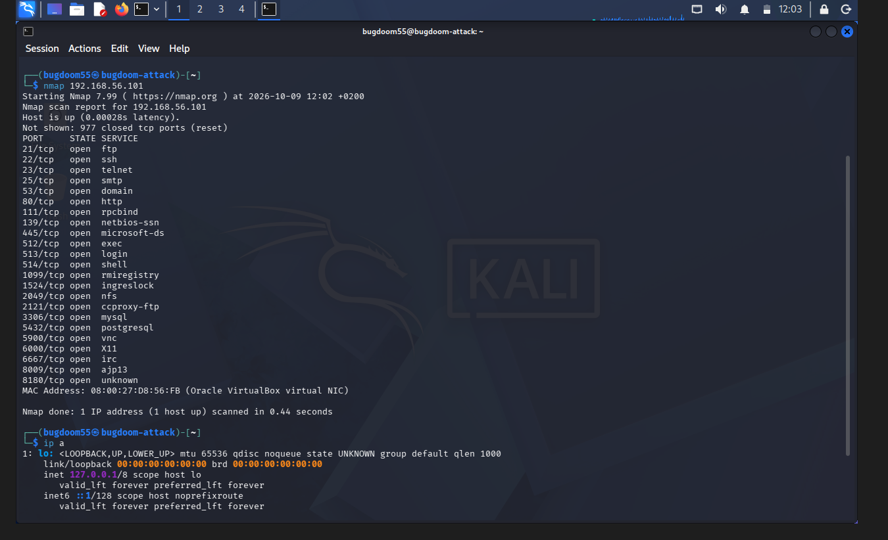
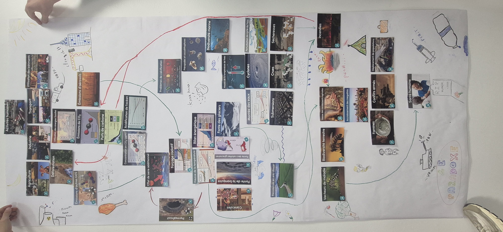

My name is Skander Badri and this is my e-portfolio. I am an engineering student at ENSEEIHT in my first year (Bac+3) and I am looking
forward to acquiring new hard and soft skills, undertaking new challenges, widening my horizons and discovering the world of Cybersecurity !

---

<div style="position: relative; padding-bottom: 56.25%; height: 0; overflow: hidden; max-width: 100%; border-radius: 8px;">
  <iframe 
    src="https://www.youtube.com/embed/_4oiJpP2rXw" 
    style="position: absolute; top: 0; left: 0; width: 100%; height: 100%; border: 0;" 
    allow="accelerometer; autoplay; clipboard-write; encrypted-media; gyroscope; picture-in-picture" 
    allowfullscreen 
    title="Cybersecurity Elevator Pitch">
  </iframe>
</div>

---


# Engineering Course

## Projects
<details>
<summary class = "projects-title">Home lab project</summary>
<div class = "homelabintro">
A home lab is a personal sandbox built to explore network administration, system hardening, and cybersecurity concepts through the practical deployment of firewalls, virtual machines, and security information and event management (SIEM) tools.
</div>
<figure>

<figcaption>Figure 1: Port scanning Metasploitable 2</figcaption>
</figure>
</details>

<details>
<summary class = "projects-title">TIPE</summary>
<div class = "homelabintro">
For my TIPE project on the theme 'cycles and loops', I worked on optimizing road traffic through intersections.
</div>
<figure>

</figure>
</details>

<!-- * ## *Guessing game* remastered -->

## Achievements / Awards 🏅
* ### *7TF* challenge        <!-- Should I put it ? -->

I placed in the top 3 among first-years at ENSEEIHT in the recent CTF challenge organized by the pony7 club. 

---

# International Mobility 🗺️

## Mobility projects

### **3 potential destinations :**

* China :
<p>
China is an economical superpower in the digital market and since I have been learning chinese for the past 2 months, I figured it wouldn't be a bad idea to study there.
</p>
* UK
<p>
The UK is home to one of the most prestigious universities in the world : The Imperial College of London.
</p>
* Malaysia
<p>
I have taken a liking to Malaysia and I can see myself working and settling there in the future so it would be good to visit my future home !
</p>
## Arabic
<div dir="rtl">
اللغة العربية لغتي الأم. اسمي بالعربية يكتب كالاتي : اسكندر بادري.
</div>

## English

Well, this entire e-portfolio is in english so...

## 我说汉语 ！

你好 ！我叫 Skander Badri。 我十九岁。我喜欢学汉语 ！

## German

Hallo ! Ich bin Skander Badri und Ich spreche ein bisschen deutsch.

## Spanish

```
Pronto :)
```

---

# Sustainability & Civic Engagement 🌵

## For Mother Nature ... 


<div class="climat-div">
  <figure class = "climatwcap">
    
    <figcaption>Climate Fresk : The paradox</figcaption>
  </figure>
  
  <div>
    I was given the opportunity to widen my understanding of the current climate crisis through working in a team on a climate fresk. <br /> <br />
    The fresk aims at explaining the multiple causes of disasters all around the world, usually traced back to human activities. <br /> <br />
    Our fresk is named "Le paradoxe" / "The paradox" because it shows how in an attempt to make peoples' lives easier and more accomodating, we ended up destroying the very world we live in.
  </div>
</div>

## " Cordées de la réussite " project


I am participating in the project "Cordées de la reussite" and my role is to give first-years in high school carreer/academic counseling and to give them the confidence boost they need in public speaking !

## The Trial of King Kong

I attended the play "Le procès de King Kong" displaying 3 situations of sexist and sexual violence (VSS) at the end of which we had to pass judgement and debate on who was the most at fault in said situation.

---

# Sport & other activities 

## Sports 💪

I like to go to the gym to build muscle and discipline. My body lives for sore muscles ! I also started running recently !

## Cooking 🍳

I find cooking very fun because it stifles my creativity and lets me experiment freely.
<!-- I really need to add more activities :\\ -->

---

# Career Development 

## CV / Resume 📑

In english ...

<a href="/assets/docs/Mr_Skander_Badri_CV.pdf" download class="contact-btn">Download Resume</a>

In french ...

<a href="/assets/docs/Mr_Skander_Badri_CV_FR.pdf" download class="contact-btn">Download Resume</a>

---

## Contact 📞

Join me on LinkedIn !

<a href="https://www.linkedin.com/in/skander-badri-536462222/?locale=en-US" class="contact-btn">LinkedIn (EN)</a>
<a href="https://www.linkedin.com/in/skander-badri-536462222/?locale=fr-FR" class="contact-btn">LinkedIn (FR)</a>

Well how about my e-mail ?

<a href="mailto:badri.skander71@gmail.com" class="contact-btn">Email Me</a>

---

## My mentors 

* <a href = "mentors/jonathan">Jonathan Bonnefoy : Analyste SOC chez Orange Cyberdéfense</a> 
<br />

* <a href = "mentors/anahid">Anahid Hanimyan : Fondatrice EVOSANCE - ex Ingenieur Nokia | Experte des métiers IT, Data, Cloud et Cybersécurité</a><br />

* <a href = "mentors/richard">Richard Chetory : Manager Opérations de l’intégration su sein de la Division Cybersécurité</a><br />

* <a href = "mentors/mudsor">Mudsor Vissault-Masood : Cybersecurity Project Manager at Plan B</a>

<!-- I still need my elevator pitch -->